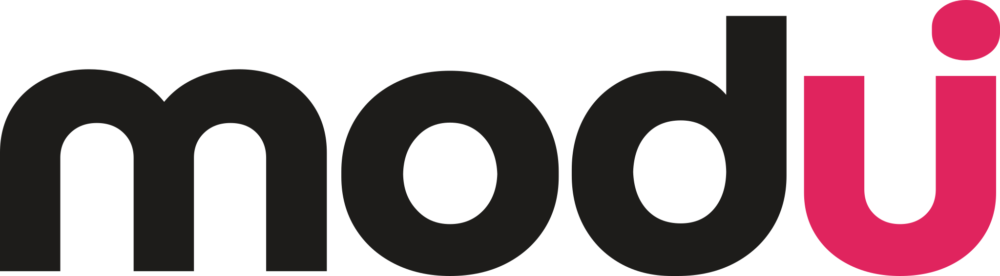

<p align="center">
  <picture>
    <source media="(prefers-color-scheme: dark)" srcset="assets/logo-on-dark.svg">
    
  </picture>
</p>

# modui MCP server

Premium UI kits in distinct styles, plus fonts, typography, text animations and motion effects, straight from your AI editor.

modui is a catalog of UI kits in recognisable styles (glass, clay, brutal, layered and more). Every kit covers every component in every state, and ships as HTML, CSS, React + TypeScript, Tailwind CSS and JSON design tokens. The MCP server lets your AI search the catalog and pull products into your project, so it builds with the kit's own tokens instead of guessing colours, radius, shadows and fonts.

**Server address:** `https://modui.dev/mcp` (remote, Streamable HTTP)

This repository only holds the documentation. The server runs at the address above; there is nothing to install.

## Tools

| Tool | What it does |
|---|---|
| `search` | Find kits, blocks, layouts, fonts, typography, text animations and motion effects by style, mood or use case |
| `kit_contents` | See everything a kit includes |
| `how_to_use` | Instructions for using a product in your stack |
| `get` | Download a product and get the command that puts the files in your project |

Typical workflow: describe the look you want, let your AI search modui, pick a kit, and pull it into the project. The AI then takes every colour, radius, shadow and font from the kit's tokens.

## Sign in

Two ways, both with your modui account:

- **Sign in through your AI app (OAuth).** Apps that support it (Claude connectors and others) open modui, you sign in, done. The server supports dynamic client registration.
- **API key.** Create a key on [modui.dev/account](https://modui.dev/account) and send it as the header `Authorization: Bearer <your key>`.

Listing the tools works without signing in. Pulling a product costs credits like a download on the site, and is free for products you already have. MCP comes with the paid plans, see [modui.dev/pricing](https://modui.dev/pricing).

## Connect

Replace `<your key>` with the key from your account page.

### Claude (app and claude.ai)

Settings > Connectors > **Add custom connector**. Name: `modui`. URL: `https://modui.dev/mcp`. Claude signs you in with your modui account.

### Claude Code

```bash
claude mcp add --transport http --scope user modui https://modui.dev/mcp --header "Authorization: Bearer <your key>"
```

### Cursor

`~/.cursor/mcp.json`:

```json
{
  "mcpServers": {
    "modui": {
      "url": "https://modui.dev/mcp",
      "headers": { "Authorization": "Bearer <your key>" }
    }
  }
}
```

### VS Code (Copilot Chat, agent mode)

Command Palette > **MCP: Open User Configuration**:

```json
{
  "servers": {
    "modui": {
      "type": "http",
      "url": "https://modui.dev/mcp",
      "headers": { "Authorization": "Bearer <your key>" }
    }
  }
}
```

### Codex

`~/.codex/config.toml`:

```toml
[mcp_servers.modui]
url = "https://modui.dev/mcp"
http_headers = { Authorization = "Bearer <your key>" }
```

### Any other MCP client

Add `https://modui.dev/mcp` as a remote (Streamable HTTP) server, with the header `Authorization: Bearer <your key>`, or let the client sign you in if it supports OAuth.

## Links

- Website: [modui.dev](https://modui.dev)
- Pricing: [modui.dev/pricing](https://modui.dev/pricing)
- Your API keys: [modui.dev/account](https://modui.dev/account)
